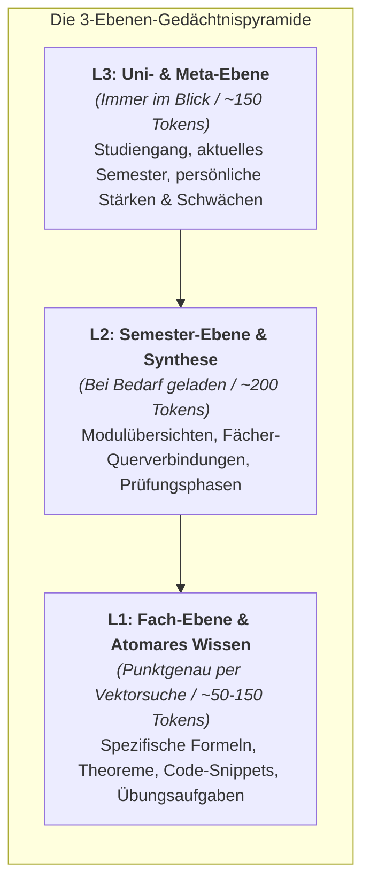
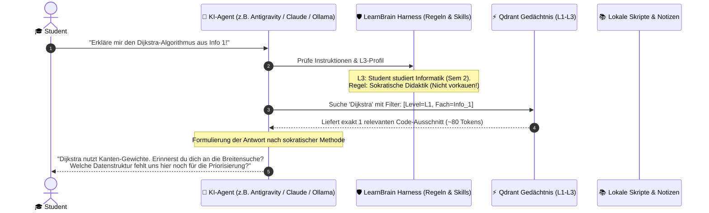
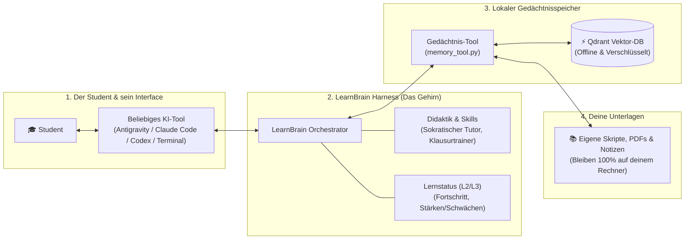

# OpenLearnBrain: LearnBrain

> Ein lokaler, datenschutzkonformer **Learning Agent Harness** mit hierarchischem Gedächtnis – entwickelt für Studierende, vollständig quelloffen (FOSS) und ohne versteckte Abos.

---

## 🎯 1. Das Ziel & die Vision

Mit **LearnBrain** entsteht das Herzstück der **OpenLearnBrain**-Organisation: ein intelligenter, geführter KI-Lernharness, der Studierende interaktiv durch komplexe Vorlesungsinhalte begleitet, anstatt nur fertige Lösungen vorzukauen.

### Die OpenLearnBrain-Philosophie (FOSS)
* **100 % Frei & Open Source (FOSS):** Freier Zugang zu moderner Bildungstechnologie ohne Paywalls, teure Monatsabos oder Datenverkauf.
* **Open Plugin-Ecosystem:** LearnBrain bildet das modulare Fundament. Über die Organisation *OpenLearnBrain* werden zukünftig spezialisierte Plugins bereitgestellt (z. B. automatisierte Code-Befundung, Flashcard-Generatoren, Spaced-Repetition-Systeme und LMS-Integrationen).
* **Volle Datenhoheit & Privatsphäre:** Universitätsunterlagen, Skripte und Notizen bleiben 100 % lokal auf dem Rechner des Studierenden.
* **Harness- & Tool-Agnostisch:** Der Nutzer entscheidet frei, mit welchem KI-Tool gearbeitet wird (Antigravity, Claude Code, OpenAI Codex oder lokale Open-Weights-Modelle via Ollama).

---

## 🧠 2. Das 3-Stufen-Gedächtnis (L1 bis L3)

Herkömmliche Chatbots und RAG-Systeme fluten das Kontextfenster mit Hunderten Seiten Skripten. LearnBrain nutzt stattdessen eine dreistufige, tokensparende Gedächtnishierarchie.

### Die Schreibtisch-Metapher (Einfach erklärt für Nicht-Techniker)

Man kann sich das Gedächtnis von LearnBrain wie einen gut organisierten Schreibtisch eines erfolgreichen Studenten vorstellen:

1. **L3 (Auf dem Schreibtisch – Immer im Blick):** Dein Studienausweis, dein aktuelles Semester und dein Lernziel. Es nimmt fast keinen Platz weg (~150 Tokens), aber die KI weiß zu jeder Sekunde, wer du bist und wo du im Studium stehst.
2. **L2 (In der Schreibtischschublade – Griffbereit bei Bedarf):** Die Semestermappe mit dem Stundenplan und den Zusammenfassungen. Wenn du planst oder Fächer vergleichst, wird sie kurz herausgeholt (~200 Tokens).
3. **L1 (Im Archiv-Regal – Gezielt nachgeschlagen):** Die riesigen Ordner mit tausenden Seiten Skripten, Formeln und Aufgaben. Anstatt alle Ordner auf den Schreibtisch zu kippen, holt die KI blitzschnell nur die eine benötigte Karteikarte mit der gesuchten Formel heraus (~50–150 Tokens).

### Visuelle Darstellung der Gedächtnis-Pyramide



### Übersicht der Stufen

| Stufe | Ebene | Inhalt | Analogie | Abruf & Token-Budget |
| :--- | :--- | :--- | :--- | :--- |
| **L3** | **Uni / Meta** | Studiengang, Semester, Prüfungsordnung, Lernfortschritt. | *Der Schreibtisch* | **Always-in-Context** (`AGENTS.md` / `state/`), ca. **100–150 Tokens**. |
| **L2** | **Semester** | Modulübersichten, Querverbindungen, Klausurphasen. | *Die Semestermappe* | **On-Demand** bei Semesterthemen (`README.md`), ca. **200 Tokens**. |
| **L1** | **Atomar / Fach** | Konkrete Definitionen, Theoreme, Formeln, Code, Übungen. | *Die Karteikarte aus dem Regal* | **Selektive Vektorsuche** via Qdrant, ca. **50–150 Tokens** pro Treffer. |

---

## 🔄 3. Wie das Gesamtsystem funktioniert (Der Ablauf im Alltag)

Das folgende Schaubild zeigt, wie die einzelnen Module zusammenarbeiten, wenn ein Student dem System eine Frage stellt:



---

## 🧩 4. Modul-Architektur von LearnBrain

Für Nicht-Techniker lässt sich die Architektur in vier verständliche Bausteine unterteilen:



### Die 4 Bausteine im Detail:
1. **Das Interface (Freie Wahl):** Du bist nicht an eine bestimmte App gebunden. Du kannst Antigravity, Claude Code, Cursor oder ein lokales Open-Source-Modell im Terminal nutzen.
2. **Der Harness (Der Dirigent):** Er sorgt dafür, dass die KI nicht einfach deine Hausaufgaben löst, sondern dir als geduldiger Tutor hilft, den Stoff selbst zu verstehen.
3. **Das Gedächtnis (Der Filter):** Qdrant sorgt dafür, dass aus tausenden Seiten Vorlesungsunterlagen in Millisekunden genau die richtige Information herausgefiltert wird.
4. **Deine Unterlagen (Die Datenhoheit):** Alle PDFs, Markdown-Dateien und Vorlesungsfolien bleiben auf deinem Laptop. Es gibt keinen Cloud-Upload.

---

## ⚡ 5. Tool-Entscheidung: Qdrant (lokal)

Als Vektorspeicher und Retrieval-Engine setzt LearnBrain auf **lokales Qdrant** (via Docker oder dateibasiertem Python-Client):

* **Warum Qdrant?**
  * **Payload-Filtering:** Ermöglicht deterministisches Filtern nach Metadaten (z. B. `level == L1` UND `fach == Mathe_1`), wodurch null Token-Rauschen aus anderen Fächern entsteht.
  * **Maximale Performance:** In Rust geschrieben, extrem ressourcenschonend und mit Suchzeiten unter 5 ms.
* **Warum keine Alternativen?**
  * *Letta (MemGPT):* Verursacht ein „Harness-in-a-Harness“-Problem, da Antigravity/Claude Code bereits als Agent-Harness fungieren.
  * *LightRAG:* Lokales Indizieren ganzer Vorlesungsskripte per Graph-Extraktion ist auf lokaler Hardware zu rechenintensiv.

---

## 📁 6. Struktur des Harness-Workspace

```text
LearnBrain/
├── AGENTS.md                   # [L3] Globale Instruktionen, Profil, Sokratische Lehrmethode
├── state/                      # [L3 & L2] Dynamischer Status (Lernfortschritt, Noten, Deadlines)
│   ├── student_profile.md      # [L3] Persönliches Lernprofil, Stärken & Schwächen
│   └── current_semester.json   # [L2] Aktueller Semester-Fahrplan
├── skills/                     # Didaktische Workflows für den Agenten
│   ├── socratic-tutor/         # Lehrmethode (Gezielte Rückfragen statt Vorsagen)
│   └── exam-simulation/       # Generierung realistischer Klausuraufgaben
├── tools/                      # Lokales Gedächtnis-Interface
│   ├── indexer.py              # Skript zum Einlesen von PDFs/Notizen in Qdrant (mit L1-L3 Tags)
│   └── memory_tool.py          # CLI-Tool für die KI zum punktgenauen Suchen
└── library/                    # Eigene Vorlesungsunterlagen
    └── Semester_X/
        ├── README.md           # [L2] Modul-Zusammenfassungen
        └── Fach_Y/             # [L1] Skripte, Notizen, Übungen
```

---

## 🚀 7. Die Kernvorteile auf einen Blick

1. **Tokensparend:** Das System lädt niemals ganze Skripte, sondern nur punktuell 2–3 Absätze (oft unter 200 Tokens Gesamtoverhead).
2. **Didaktisch geführt:** Der Harness zwingt die KI über Skills dazu, dich mit gezielten Fragen zur Lösung zu führen, statt Hausaufgaben für dich zu erledigen.
3. **100 % lokal & privat:** Alle Skripte, Notizen und Embeddings laufen offline (z. B. über Ollama + Qdrant) auf deinem Rechner.
4. **Harness-Agnostisch:** Funktioniert nahtlos mit Antigravity, Claude Code, Cursor oder Codex.

---

## 🛠️ 8. Status & Roadmap

Das Projekt befindet sich in der aktiven **Architektur- und Prototypenphase**:

- [x] Konzeption der 3-Ebenen-Gedächtnisarchitektur (L1–L3)
- [x] Repository-Setup & OpenLearnBrain-Organisation
- [ ] Implementierung des lokalen Qdrant-Indexers (`tools/indexer.py`)
- [ ] Implementierung des Retrieval-CLI-Tools (`tools/memory_tool.py`)
- [ ] Formulierung der Kern-Skills (Sokratischer Tutor, Klausurvorbereitung)
- [ ] Pilotversuch mit einem universitären Modul
