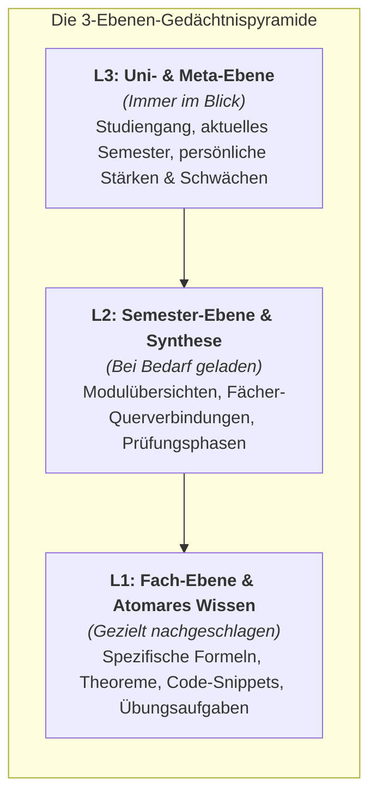
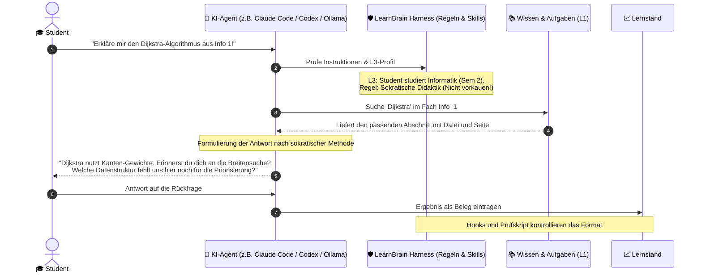
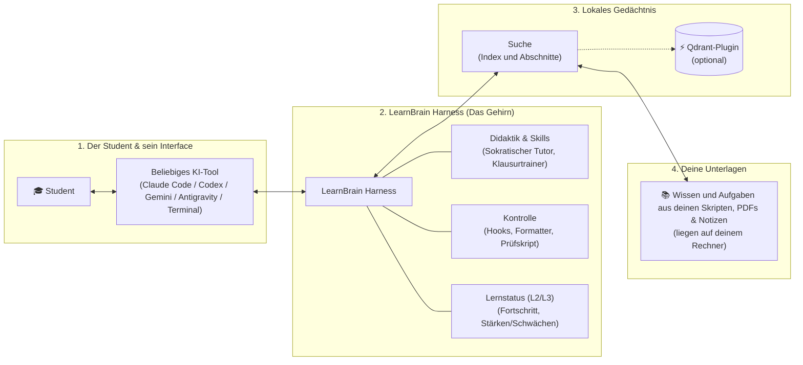

# OpenLearnBrain: LearnBrain

> Ein lokaler, quelloffener **Learning Agent Harness** mit hierarchischem Gedächtnis – für Studierende und alle, die mit ihren eigenen Unterlagen lernen wollen, vollständig FOSS und ohne versteckte Abos.

> **Status:** Architektur- und Prototypenphase. Es gibt noch keine installierbare Version, siehe Abschnitt 13.

---

## 🎯 1. Das Ziel & die Vision

Mit **LearnBrain** entsteht das Herzstück der **OpenLearnBrain**-Organisation: ein intelligenter, geführter KI-Lernharness, der Studierende interaktiv durch komplexe Vorlesungsinhalte begleitet, anstatt nur fertige Lösungen vorzukauen.

LearnBrain ist ein **Harness für bestehende KI-Harnesse**. Du installierst es in einen Ordner, und der wird zu deinem persönlichen Lernsystem. Agenten wie Claude Code, Codex, Gemini oder Antigravity nutzt du weiter wie gewohnt, aber in diesem Ordner müssen sie feste Regeln einhalten.

### Für wen

LearnBrain soll für alle ein hilfreiches Werkzeug sein, die mit ihren eigenen Unterlagen lernen wollen, nicht nur für Power User. Du brauchst nur einen KI-Agenten, den Rest richtet der Installer ein. Nach der Installation ist der Ordner leer. Das ist gewollt: Du entscheidest, was hineinkommt und was du damit lernst.

Erprobt wird es bisher mit Informatik und Mathematik, andere Fächer werden noch getestet.

### Die OpenLearnBrain-Philosophie (FOSS)
* **100 % Frei & Open Source (FOSS):** Freier Zugang zu moderner Bildungstechnologie ohne Paywalls, teure Monatsabos oder Datenverkauf.
* **Open Plugin-Ecosystem:** LearnBrain bildet das modulare Fundament. Über die Organisation *OpenLearnBrain* werden zukünftig spezialisierte Plugins bereitgestellt (z. B. automatisierte Code-Befundung, Flashcard-Generatoren, Anbindungen an Spaced-Repetition-Systeme, LMS-Integrationen und semantische Suche mit Qdrant).
* **Volle Datenhoheit:** Unterlagen, Skripte und Notizen liegen lokal auf deinem Rechner, und du entscheidest, welches Modell was zu sehen bekommt.
* **Harness- & Tool-Agnostisch:** Du entscheidest frei, mit welchem KI-Tool du arbeitest (z. B. Claude Code, OpenAI Codex, Gemini, Antigravity oder lokale Open-Weights-Modelle via Ollama).

---

## 🧠 2. Das 3-Stufen-Gedächtnis (L1 bis L3)

Herkömmliche Chatbots und RAG-Systeme fluten das Kontextfenster mit Hunderten Seiten Skripten. LearnBrain nutzt stattdessen eine dreistufige, tokensparende Gedächtnishierarchie.

### Die Schreibtisch-Metapher (Einfach erklärt für Nicht-Techniker)

Man kann sich das Gedächtnis von LearnBrain wie einen gut organisierten Schreibtisch eines erfolgreichen Studenten vorstellen:

1. **L3 (Auf dem Schreibtisch – Immer im Blick):** Das aktuelle Semester und deine Lernziele. Es nimmt wenig Platz weg, aber die KI weiß zu jeder Sekunde, wer du bist und wo du im Studium stehst.
2. **L2 (In der Schreibtischschublade – Griffbereit bei Bedarf):** Die Semestermappe mit dem Stundenplan und den Zusammenfassungen. Wenn du planst oder Fächer vergleichst, wird sie kurz herausgeholt.
3. **L1 (Im Archiv-Regal – Gezielt nachgeschlagen):** Die riesigen Ordner mit tausenden Seiten Skripten, Formeln und Aufgaben. Anstatt alle Ordner auf den Schreibtisch zu kippen, holt die KI nur die eine benötigte Karteikarte mit der gesuchten Formel heraus.

### Visuelle Darstellung der Gedächtnis-Pyramide



### Übersicht der Stufen

| Stufe | Ebene | Inhalt | Analogie | Abruf |
| :--- | :--- | :--- | :--- | :--- |
| **L3** | **Uni / Meta** | Studiengang, Semester, Prüfungsordnung, Überblick über Stärken und Schwächen (aus dem Lernstand berechnet). | *Der Schreibtisch* | **Always-in-Context** (`AGENTS.md` / `state/`), so kurz wie möglich. |
| **L2** | **Semester** | Modulübersichten, Querverbindungen, Klausurphasen. | *Die Semestermappe* | **On-Demand** bei Semesterthemen (`state/`). |
| **L1** | **Atomar / Fach** | Konkrete Definitionen, Theoreme, Formeln, Code, Übungen. | *Die Karteikarte aus dem Regal* | **Gezielt** in `faecher/<fach>/`: erst der Index, dann der passende Abschnitt. |

---

## 🔄 3. Wie das Gesamtsystem funktioniert (Der Ablauf im Alltag)

### Von der Installation zum Lernen

1. **Installieren:** Ein Befehl legt den Ordner an. Der Installer richtet alles ein, auch lokales Git und die Hooks. Ein GitHub-Konto brauchst du nicht.
2. **Einrichten:** Du gibst Semester, Fächer und Klausurtermine an.
3. **Füllen:** Du legst deine Unterlagen in `quellen/` und entscheidest, was mit welchem Modell eingelesen wird.
4. **Lernen:** Du arbeitest wie gewohnt mit deinem Agenten. LearnBrain zeigt, was heute dran ist, und hält fest, was du kannst.
5. **Erinnert werden:** Ein Cron-Job schaut, was ansteht, und meldet sich auf deinem Laptop.
6. **Aktualisieren:** Ein Befehl erneuert das System. Deine Inhalte und dein Lernstand bleiben.

### Eine Frage im Alltag

Das folgende Schaubild zeigt, wie die einzelnen Module zusammenarbeiten, wenn ein Student dem System eine Frage stellt:



---

## 🧩 4. Modul-Architektur von LearnBrain

Für Nicht-Techniker lässt sich die Architektur in vier verständliche Bausteine unterteilen:



### Die 4 Bausteine im Detail:
1. **Das Interface (Freie Wahl):** Du bist nicht an eine bestimmte App gebunden. Du kannst Claude Code, Codex, Gemini, Antigravity, Cursor oder ein lokales Open-Source-Modell im Terminal nutzen.
2. **Der Harness (Der Dirigent):** Feste Regeln, Hooks, Formatter und Skripte bestimmen, wie Agenten in deinem Ordner arbeiten. Die Skills führen die KI dazu, dir als geduldiger Tutor zu helfen, statt deine Hausaufgaben zu lösen.
3. **Das Gedächtnis (Der Filter):** Zuerst der Index, dann der passende Abschnitt mit Datei und Seite. Mit dem Qdrant-Plugin kommt semantische Suche dazu.
4. **Deine Unterlagen (Die Datenhoheit):** Alle PDFs, Markdown-Dateien und Vorlesungsfolien liegen auf deinem Rechner. Was dein Agent davon liest, entscheidest du.

---

## ⚡ 5. Tool-Entscheidung: Stichwortsuche als Standard, Qdrant als Plugin

Standard ist eine **Stichwortsuche** über die Abschnitte in `wissen/`. Sie braucht keine Datenbank und behält die Seitenangaben.

**Qdrant** kommt als optionales Plugin für semantische Suche dazu (via Docker oder dateibasiertem Python-Client). Der Index entsteht nur aus `wissen/` und lässt sich jederzeit neu erzeugen. PDFs werden nie direkt indiziert.

* **Warum Qdrant als Plugin?**
  * **Payload-Filtering:** Ermöglicht deterministisches Filtern nach Metadaten (z. B. `level == L1` UND `fach == Mathe_1`), wodurch null Token-Rauschen aus anderen Fächern entsteht.
  * **Maximale Performance:** In Rust geschrieben, extrem ressourcenschonend und mit Suchzeiten unter 5 ms.
* **Warum keine Alternativen?**
  * *Letta (MemGPT):* Bringt eine eigene Agenten-Laufzeit mit, die neben Claude Code und Co. nicht gebraucht wird.
  * *LightRAG:* Lokales Indizieren ganzer Vorlesungsskripte per Graph-Extraktion ist auf lokaler Hardware zu rechenintensiv.

---

## 📁 6. Struktur nach der Installation

```text
mein-learnbrain/
├── AGENTS.md                     # [L3] Einstieg für jeden Agenten, kurz und immer geladen
├── state/                        # [L3 & L2] Deine Angaben und dein Stand
│   ├── student_profile.md        # [L3] Studiengang, Stärken & Schwächen (aus dem Lernstand)
│   └── current_semester.json     # [L2] Semester, Fächer, Klausurtermine
├── .learnbrain/                  # System: Regelwerk, Skripte, Skills, Adapter
└── faecher/
    └── <fach>/
        ├── AGENTS.md             # Fachkontext: Prüfung, Werkzeuge, Stand
        ├── notizen.md            # Sonstiges, mit festen Pflichtelementen
        ├── quellen/              # Deine Originale, unverändert
        ├── wissen/               # [L1] Eingelesenes mit Seitenangaben, Index, Lernziele, Klausurprofil
        ├── aufgaben/             # [L1] Aufgabenbank, Übungsblätter, Probeklausuren
        └── lernstand/            # Was du kannst, was fällig ist, deine Fehler
```

---

## 📏 7. Feste Regeln

Damit jedes Werkzeug die Dateien gleich lesen kann, ist der Rahmen fest. Freier Text darf sich unterscheiden, Aufbau und Felder nicht.

1. `quellen/` wird nie verändert.
2. Alles Abgeleitete nennt Datei und Seite.
3. Lernziele haben feste IDs, die nie umbenannt werden.
4. Der Lernstand entsteht nur aus dokumentierten Ergebnissen.
5. Aufgaben tragen `pruefung: ausfuehrung | quelle | entwurf`. Nur geprüfte Aufgaben zählen für den Lernstand.
6. Beim Üben wird erst abgefragt, dann erklärt.
7. Es gibt nur die vorgesehenen Dateien, Ordner und Felder. Für Sonstiges hat jedes Fach genau eine Datei, `notizen.md`, mit festen Pflichtelementen.

Durchgesetzt wird das technisch:

| Ebene | Aufgabe |
| :--- | :--- |
| **Adapter je Harness** | Prüfen schon beim Schreiben, über die Hooks des jeweiligen Harness |
| **Formatter** | Bringen Dateien automatisch in die richtige Form, ändern aber nie Belege oder Quellen |
| **Prüfskript** | Findet Verstöße gegen Aufbau, Formate und IDs und rechnet den Lernstand nach |
| **Git-Hook** | Letzte Prüfung vor jedem Commit |

---

## 🎓 8. Lernen mit LearnBrain

- **Wissen aus deinen Unterlagen:** Aus Folien und Skripten entstehen Markdown-Dateien mit Datei- und Seitenangabe.
- **Lernziele mit festen IDs:** Wissen, Aufgaben und Lernstand verweisen auf dieselben Lernziele.
- **Aufgabenbank:** Jede Aufgabe gibt an, wie ihre Lösung geprüft wurde.
- **Lernstand aus Belegen:** Es zählen dokumentierte Ergebnisse, nicht „kann ich schon“.
- **Wiederholung nach Plan:** Je nach Ergebnis nach 1, 3, 7, 14, 30 oder 60 Tagen.
- **Geführtes Lernen:** Erst fragen, dann erklären, Hilfe in vier Stufen, die Lösung erst nach deiner Antwort.

Die Skills werden dort installiert, wo der jeweilige Harness sie erwartet:

- `socratic-tutor`: Lerngespräch zum Verstehen, mit gezielten Rückfragen statt Vorsagen
- `exam-simulation`: Realistische Probeklausuren erzeugen und auswerten, die Ergebnisse fließen in den Lernstand

---

## ⌨️ 9. Geplante Befehle

Die Namen können sich noch ändern. Die Skripte brauchen nur Node.

| Befehl | Zweck |
| :--- | :--- |
| `learnbrain init` | Ordner anlegen und einrichten |
| `learnbrain fach <name>` | Fach anlegen |
| `learnbrain heute` | Zeigen, was ansteht |
| `learnbrain aufgabe <id>` | Aufgabe ohne Lösung ausgeben |
| `learnbrain beleg <aufgabe> <ergebnis>` | Ergebnis in den Lernstand eintragen |
| `learnbrain suche <begriff>` | Passende Abschnitte finden |
| `learnbrain pruefen` | Regeln prüfen und die Form reparieren |
| `learnbrain update` | System aktualisieren |

---

## 🔐 10. Modelle und Daten

- Welche Modelle du nutzt, entscheidest du. LearnBrain gibt nur Empfehlungen.
- LearnBrain selbst kostet nichts. Kosten entstehen nur bei dem KI-Anbieter, den du wählst.
- Deine Dateien liegen lokal. Was dein Agent liest, geht an den Anbieter des Modells, das du gewählt hast. Mit einem lokalen Modell bleibt alles auf deinem Rechner.
- LearnBrain stellt nur das Gerüst bereit und liefert keine Inhalte mit. Welche Daten du verwendest und wohin du sie schickst, entscheidest und verantwortest du selbst.
- GitHub ist freiwillig. Wenn du es nutzt, empfehlen wir ein privates Repo, weil darin deine Folien und Klausuren liegen.

---

## ♻️ 11. Updates

1. Das System liegt in `.learnbrain/`. Ein Update ersetzt nur das und die daraus erzeugten Dateien für die einzelnen Harnesse.
2. Deine Daten tragen eine Formatversion.
3. `learnbrain update` sichert zuerst, tauscht das System, führt die Migrationen aus und prüft das Ergebnis. Geht etwas schief, wird automatisch zurückgerollt.
4. Migrationen fassen `quellen/` nie an.
5. Neue Prüfregeln laufen eine Version lang nur als Hinweis, damit sie niemanden blockieren.
6. Geladen wird aus öffentlichen Releases, dafür braucht niemand ein GitHub-Konto.

---

## 🚀 12. Die Kernvorteile auf einen Blick

1. **Tokensparend:** Der Agent lädt nicht ganze Skripte, sondern gezielt den Abschnitt, den er braucht.
2. **Didaktisch geführt:** Die Skills führen die KI dazu, dich mit gezielten Fragen zur Lösung zu bringen, statt Hausaufgaben für dich zu erledigen.
3. **Verlässlich:** Feste Regeln, Hooks und Skripte halten jede Datei im richtigen Format. Wissen nennt Datei und Seite, der Lernstand entsteht nur aus Belegen.
4. **Deine Daten, deine Wahl:** Alles liegt lokal, und du entscheidest, welches Modell was zu sehen bekommt.
5. **Harness-Agnostisch:** Gedacht für Claude Code, Codex, Gemini, Antigravity oder Cursor.

---

## 🛠️ 13. Status & Roadmap

Das Projekt befindet sich in der aktiven **Architektur- und Prototypenphase**:

- [x] Konzeption der 3-Ebenen-Gedächtnisarchitektur (L1–L3)
- [x] Repository-Setup & OpenLearnBrain-Organisation
- [x] Privater Prototyp: Aufbau je Fach, Lernziele, Aufgabenbank, Lernstand mit Wiederholungsplan, Prüfskript, Git-Hook, Übungsskript
- [ ] Installer
- [ ] Trennung von System und Nutzerdaten
- [ ] Updates und Migrationen
- [ ] Adapter je Harness
- [ ] Formatter und Auto-Fix
- [ ] Laderegeln für L1 bis L3
- [ ] Stichwortsuche (`learnbrain suche`)
- [ ] Optionales Qdrant-Plugin
- [ ] Formulierung der Kern-Skills (Sokratischer Tutor, Klausurvorbereitung)
- [ ] Cron-Job mit Meldung
- [ ] Pflichtelemente von `notizen.md`
- [ ] Test mit weiteren Fächern
- [ ] Pilotversuch mit einem universitären Modul
- [ ] Lizenz
